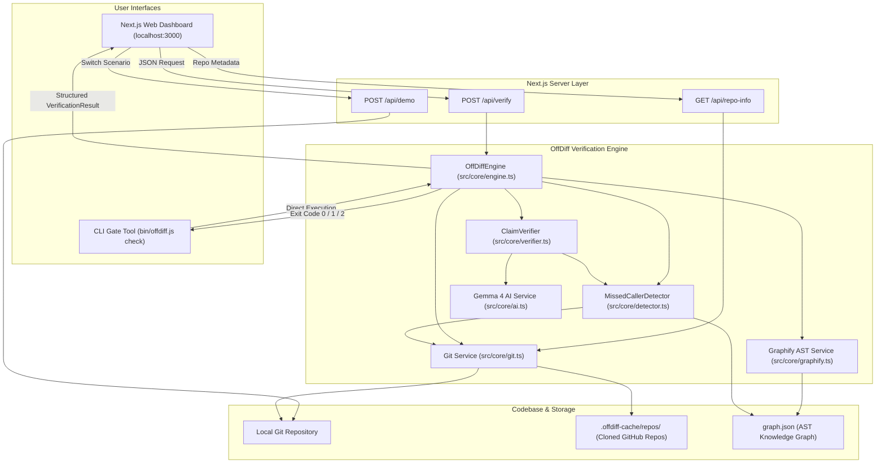
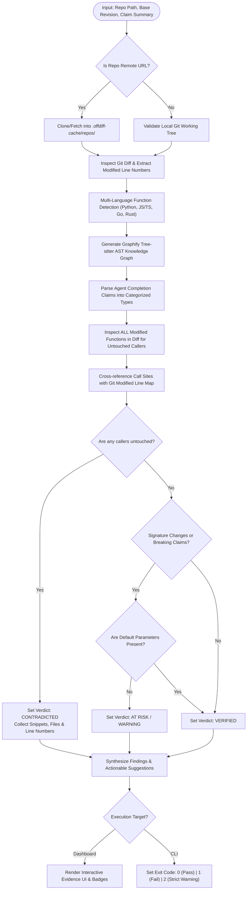
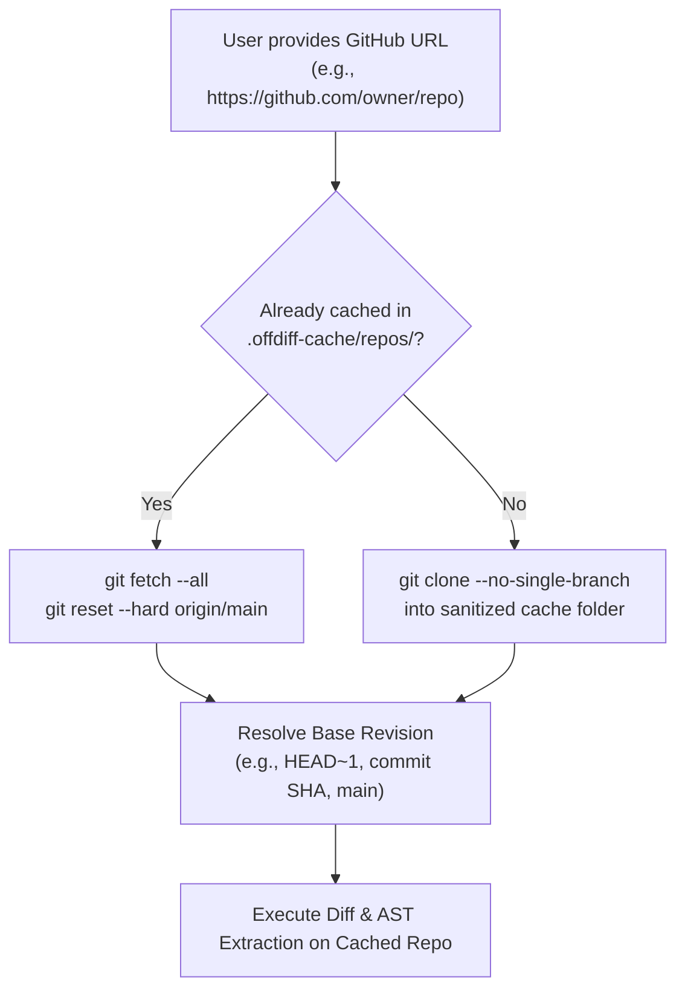

# OffDiff — AI Coding Agent Completion Claim Verifier

[](https://github.com/jagadiswarambati)
[](https://www.typescriptlang.org/)
[](https://nextjs.org/)
[](https://nodejs.org/)
[](https://opensource.org/licenses/MIT)

> **OffDiff** solves the *"Untouched Code Blind Spot"*. It identifies potentially affected untouched code in Git repositories, investigates it using AST code graphs and source evidence, and deterministically verifies whether AI coding agents' completion claims are true.

---

## Table of Contents

1. [The Problem: AI Agent Hallucinations & The Untouched Code Blind Spot](#1-the-problem)
2. [High-Level Architecture & Flowcharts](#2-high-level-architecture--flowcharts)
   - [System Architecture Diagram](#system-architecture-diagram)
   - [Verification Pipeline Flowchart](#verification-pipeline-flowchart)
   - [Remote GitHub Cloning & Caching Flow](#remote-github-cloning--caching-flow)
3. [Key Capabilities & Features](#3-key-capabilities--features)
4. [Technology Stack](#4-technology-stack)
5. [Repository Structure](#5-repository-structure)
6. [Prerequisites & Installation](#6-prerequisites--installation)
7. [Web Dashboard Walkthrough](#7-web-dashboard-walkthrough)
8. [CLI Gate & CI/CD Integration](#8-cli-gate--cicd-integration)
9. [Mandatory Demo Scenarios (One-Click Setup)](#9-mandatory-demo-scenarios)
10. [API Reference & Zod Schemas](#10-api-reference--zod-schemas)
11. [Automated Test Suite (22 Acceptance Tests)](#11-automated-test-suite)
12. [Frequently Asked Questions & Troubleshooting](#12-frequently-asked-questions--troubleshooting)
13. [License](#13-license)

---

## 1. The Problem

AI coding agents (e.g. Devin, Claude Code, Cursor, Copilot Workspace) frequently report confident completion summaries such as:
- *"Updated all callers of get_price to pass the new currency argument."*
- *"Removed every reference to legacy_calculate_tax."*
- *"No breaking changes introduced in this refactor."*

### Why Standard Git Diffs Fail
Standard Git diffs only show **lines that were added, modified, or deleted**.
If an agent modified 2 out of 3 callers and silently missed the third caller, that untouched caller **never appears in the Git diff**.
Code review tools and CI/CD pipelines reviewing only the Git diff are blind to this untouched code:

```
┌────────────────────────────────────────────────────────────────────────┐
│                          PR GIT DIFF (What humans and CI see)          │
├────────────────────────────────────────────────────────────────────────┤
│  pricing.py                                                            │
│  - def get_price(sku):                                                 │
│  + def get_price(sku, currency):                                       │
│                                                                        │
│  - def invoice_total(sku): return get_price(sku)                       │
│  + def invoice_total(sku): return get_price(sku, "INR")                │
│                                                                        │
│  - def export_total(sku): return get_price(sku)                        │
│  + def export_total(sku): return get_price(sku, "INR")                 │
└────────────────────────────────────────────────────────────────────────┘

┌────────────────────────────────────────────────────────────────────────┐
│                 HIDDEN UNTOUCHED CODE (What OffDiff Catches!)          │
├────────────────────────────────────────────────────────────────────────┤
│  pricing.py: line 11 (UNTOUCHED)                                       │
│    def receipt_total(sku):                                             │
│  >     return get_price(sku)   <-- CRASH: Missing 'currency' argument! │
└────────────────────────────────────────────────────────────────────────┘
```

OffDiff bridges this gap by cross-referencing **Git modified line maps**, **Tree-sitter/Graphify AST code graphs**, and **verbatim file verification** to detect untouched callers, pinpointing the exact file, line number, and code snippet.

---

## 2. High-Level Architecture & Flowcharts

### System Architecture Diagram



---

### Verification Pipeline Flowchart



---

### Remote GitHub Cloning & Caching Flow



---

## 3. Key Capabilities & Features

- **Untouched Caller Detection**: Combines AST call graph traversal with exact Git diff modified-line cross-referencing. If a function is updated but one of its callers remains untouched, OffDiff flags it instantly.
- **Whole-Repository Problem Discovery**: Inspects **every** function modified across all files in the diff—not just the first function or the one mentioned in the summary.
- **Dynamic Git Revision Support**: Compare working tree or HEAD against any valid Git revision:
  - `HEAD~1` (immediate parent commit)
  - `HEAD~2`, `HEAD~3` (multiple commits back)
  - Specific commit SHA hashes (e.g. `1b63b6b`, `8c70a92`)
  - Branch names (e.g. `main`, `master`, `dev`)
  - Revision ranges (e.g. `main..HEAD`)
- **Remote GitHub Repository Verification**: Provide any public GitHub repository URL (e.g. `https://github.com/jagadiswarambati/DoddleMind`). OffDiff clones, caches, and inspects remote code automatically.
- **Auto-Detection of Claims from Git Commits**: Click `⚡ Auto-Detect Claim from Commit` to extract real commit messages and file changes into verified claims.
- **Multi-Language AST Support**: Robust AST and regex parser detecting functions and callers in **Python**, **JavaScript**, **TypeScript**, **React JSX/TSX**, **Go**, and **Rust**.
- **100% Deterministic by Default**: Zero hallucination risk. Evidence snippets, line numbers, and verdicts are proven directly from repository files on disk.
- **Optional Gemma 4 AI Semantic Investigation**: When enabled with a Google GenAI key, invokes Gemma 4 (`gemma-4-26b-a4b-it`) to analyze nuanced semantic claims, validating all quoted snippets against the file tree.
- **Production CLI Gate**: Integrates into CI/CD pipelines with deterministic exit codes (`0` for PASS, `1` for FAIL, `2` for STRICT WARNING).

---

## 4. Technology Stack

| Layer | Technologies |
|---|---|
| **Frontend Framework** | Next.js 15.5 (App Router), React 19, Tailwind CSS |
| **Icons & UI** | Lucide React, Picocolors |
| **Backend & CLI Runtime** | Node.js v18+ / v24, TypeScript 5.9, TSX |
| **AST Code Graph** | Graphify (`graphifyy`), Tree-sitter AST call relations |
| **Git Engine** | Native `git` CLI child processes with buffer management |
| **Schema Validation** | Zod (v3.25) |
| **Optional AI Service** | `@google/genai` (Gemma 4 model family) |
| **Testing Harness** | Node.js Native Test Runner (`node:test`, `node:assert`) |

---

## 5. Repository Structure

```
offdiff/
├── bin/
│   └── offdiff.js             # CLI binary executable (npm link / npx runner)
├── src/
│   ├── app/
│   │   ├── api/
│   │   │   ├── demo/route.ts      # Demo repository scenario switching API
│   │   │   ├── repo-info/route.ts # Commit metadata & auto-claim detection API
│   │   │   └── verify/route.ts    # Main verification execution API
│   │   ├── globals.css        # Tailwind styling & dark theme variables
│   │   ├── layout.tsx         # Next.js Root Layout & metadata
│   │   └── page.tsx           # Interactive Web Dashboard UI
│   ├── cli/
│   │   ├── index.ts           # Commander CLI commands, formatting & exit codes
│   │   └── runner.ts          # CLI execution bootstrap script
│   ├── core/
│   │   ├── ai.ts              # Google GenAI / Gemma 4 semantic investigation
│   │   ├── detector.ts        # AST & source MissedCallerDetector
│   │   ├── engine.ts          # Central OffDiff verification orchestration engine
│   │   ├── git.ts             # Git repository inspection & remote cloning service
│   │   ├── graphify.ts        # Graphify AST knowledge graph generator & parser
│   │   ├── types.ts           # Zod schemas & TypeScript type contracts
│   │   └── verifier.ts        # ClaimVerifier, AST inspection & breaking change logic
│   └── demo/
│       └── setupDemo.ts       # Reproducible demo repo setup (incomplete/complete)
├── test/
│   └── offdiff.test.ts        # 22 automated acceptance tests
├── demo-repo/                 # Local demo repository fixture
├── .offdiff-cache/            # Cloned remote GitHub repositories (git-ignored)
├── package.json               # Dependencies and npm scripts
├── tsconfig.json              # TypeScript configuration
└── README.md                  # Comprehensive project documentation
```

---

## 6. Prerequisites & Installation

### Prerequisites
- **Node.js**: v18.0.0 or higher (v20+ or v24 recommended)
- **Python**: v3.10+ (for Graphify Tree-sitter AST extraction)
- **Git**: Installed and available on your system `PATH`

### Step-by-Step Installation

```bash
# 1. Clone the repository
git clone https://github.com/jagadiswarambati/offdiff.git
cd offdiff

# 2. Install Node dependencies
npm install

# 3. Install Graphify (Tree-sitter AST parser)
python -m pip install graphifyy

# 4. (Optional) Configure Google GenAI for AI Investigations
cp .env.example .env.local
# Edit .env.local:
# GEMINI_API_KEY=your_actual_api_key_here
```

---

## 7. Web Dashboard Walkthrough

Start the development server:

```bash
npm run dev
```

Open [http://localhost:3000](http://localhost:3000) in your web browser.

### Key Dashboard Features:
1. **Mandatory Demo Scenarios**: Click any of the three pre-set buttons (*Load Incomplete Refactor*, *Load Complete Refactor*, *Load Breaking Changes*) to automatically prepare the demo repository and trigger verification.
2. **Repository Path or GitHub URL**: Enter a local path (`demo-repo`, `.`) or paste any remote GitHub repository URL (`https://github.com/owner/repo`).
3. **Base Git Revision**: Set any revision reference (`HEAD~1`, `HEAD~2`, `main`, commit hash).
4. **Auto-Detect Claim**: Click the `⚡ Auto-Detect Claim from Commit` button to inspect recent commit logs and populate a realistic claim.
5. **Interactive Evidence Inspector**: Click on any claim or finding to review:
   - File path and exact line number
   - Formatted verbatim code snippet
   - Caller function vs. target function relation
   - Deterministic verification badge (with confidence rating)
6. **Detailed Tabs**:
   - **Claims & Evidence**: Every claim with verdict badges (`VERIFIED`, `CONTRADICTED`, `AT RISK`, `UNVERIFIABLE`).
   - **Dependency Analysis**: Graphify AST graph nodes, relations, and caller links.
   - **Untouched Code**: Focused view of all detected untouched call sites.
   - **Git Changes**: Modified, added, and deleted files with diff statistics.
   - **Raw JSON Output**: Complete machine-readable output payload.

---

## 8. CLI Gate & CI/CD Integration

OffDiff includes a command-line interface designed to block PRs with broken claims.

### CLI Syntax

```bash
node offdiff.js check [options]
```

### Options

| Option | Shorthand | Description | Default |
|---|---|---|---|
| `--repo <path\|url>` | `-r` | Local repository path or remote GitHub URL | `.` |
| `--base <rev>` | `-b` | Base Git revision to compare against | `HEAD~1` |
| `--summary <text>` | `-s` | AI agent completion claim summary | *(Required)* |
| `--strict` | | Fail if graph coverage is partial or at-risk findings exist | `false` |
| `--ai` | | Enable Google GenAI semantic investigation | `false` |
| `--json` | | Output raw JSON matching `VerificationResultSchema` | `false` |

### CLI Exit Codes

- **`0` (GATE PASSED)**: All claims verified; zero untouched callers detected.
- **`1` (GATE FAILED)**: Contradicted claim, untouched caller detected, or execution failure.
- **`2` (GATE STRICT WARNING)**: At-risk findings or partial AST graph coverage under `--strict`.

### Example CLI Usage

```bash
# Verify local demo repo (incomplete refactor)
node offdiff.js check --repo demo-repo --base HEAD~1 --summary "Updated all callers of get_price to pass the currency."

# Verify remote GitHub repository
node offdiff.js check --repo https://github.com/jagadiswarambati/AJR-Portfolio --base HEAD~1 --summary "Upgrade frontend components"

# Strict mode for CI/CD pipeline
node offdiff.js check --repo . --base origin/main --summary "Refactored user auth" --strict
```

### GitHub Actions CI/CD Workflow (`.github/workflows/offdiff.yml`)

```yaml
name: OffDiff Verification Gate

on:
  pull_request:
    branches: [ main ]

jobs:
  verify-claims:
    runs-on: ubuntu-latest
    steps:
      - name: Checkout Code
        uses: actions/checkout@v4
        with:
          fetch-depth: 0

      - name: Setup Node.js
        uses: actions/setup-node@v4
        with:
          node-version: 20
          cache: 'npm'

      - name: Setup Python
        uses: actions/setup-python@v5
        with:
          python-version: '3.11'

      - name: Install Dependencies
        run: |
          npm ci
          python -m pip install graphifyy

      - name: Run OffDiff Verification Gate
        run: |
          node offdiff.js check \
            --repo . \
            --base origin/main \
            --summary "${{ github.event.pull_request.title }}" \
            --strict
```

---

## 9. Mandatory Demo Scenarios

OffDiff includes built-in scenarios demonstrating both positive and negative verification outcomes:

### Scenario A: Incomplete Refactor (Missed Caller)
- **Base Version (`pricing.py`)**:
  ```python
  def get_price(sku): return 100
  def invoice_total(sku): return get_price(sku)
  def export_total(sku): return get_price(sku)
  def receipt_total(sku): return get_price(sku)
  ```
- **Refactored HEAD (`pricing.py`)**:
  ```python
  def get_price(sku, currency): return 100
  def invoice_total(sku): return get_price(sku, "INR")
  def export_total(sku): return get_price(sku, "INR")
  def receipt_total(sku): return get_price(sku)  # <-- MISSED CALLER!
  ```
- **Agent Claim**: `"Updated all callers of get_price to pass the currency."`
- **Gate Verdict**: **`CONTRADICTED (GATE FAILED)`** (Exit code: `1`)
- **OffDiff Output**: Pinpoints untouched caller in `receipt_total` at line 11.

---

### Scenario B: Complete Refactor (All Callers Updated)
- **Refactored HEAD (`pricing.py`)**:
  ```python
  def get_price(sku, currency): return 100
  def invoice_total(sku): return get_price(sku, "INR")
  def export_total(sku): return get_price(sku, "INR")
  def receipt_total(sku): return get_price(sku, "INR")  # <-- UPDATED
  ```
- **Agent Claim**: `"Updated all callers of get_price to pass the currency."`
- **Gate Verdict**: **`VERIFIED (GATE PASSED)`** (Exit code: `0`)
- **OffDiff Output**: Confirms all 3 callers updated in Git diff with zero false positives.

---

### Scenario C: Breaking Changes Check
- **Agent Claim**: `"No breaking changes."`
- **Diff Reality**: Function parameter added without default value.
- **Gate Verdict**: **`AT RISK (GATE WARNING)`** (Exit code: `0` normal, `2` in `--strict`)
- **OffDiff Output**: Flags signature modification and prompts caller inspection.

---

## 10. API Reference & Zod Schemas

### POST `/api/verify`
Executes verification for a given repository and summary claim.

#### Request Payload
```json
{
  "repoPath": "demo-repo",
  "baseRevision": "HEAD~1",
  "summary": "Updated all callers of get_price to pass the currency.",
  "strict": false,
  "useAi": false
}
```

#### Response Payload (`VerificationResult`)
```json
{
  "runId": "offdiff-1740000000000-abcde",
  "timestamp": "2026-10-31T08:00:00.000Z",
  "repoPath": "C:\\Users\\...\\demo-repo",
  "baseRevision": "HEAD~1",
  "gateStatus": "FAILED",
  "exitCode": 1,
  "summary": "Gate FAILED: 1 claim(s) contradicted by codebase evidence.",
  "suggestedAction": "Fix 1 untouched caller(s) detected: receipt_total at pricing.py:11",
  "commitInfo": {
    "subject": "refactor: updated get_price signature and some callers",
    "author": "OffDiff Demo",
    "date": "2026-10-31 13:00:00 +0530"
  },
  "claims": [
    {
      "id": "claim-1",
      "rawText": "Updated all callers of get_price to pass the currency.",
      "targetSymbol": "get_price",
      "type": "callers_updated",
      "status": "CONTRADICTED",
      "evidence": [
        {
          "id": "ev-claim-1-1",
          "claimText": "Updated all callers of get_price to pass the currency.",
          "verdict": "CONTRADICTED",
          "filePath": "pricing.py",
          "lineNumber": 11,
          "snippet": "def receipt_total(sku):\n    return get_price(sku)",
          "callerName": "receipt_total",
          "targetSymbol": "get_price",
          "explanation": "Call to 'get_price' in function 'receipt_total' remains UNTOUCHED at line 11.",
          "source": "deterministic",
          "confidence": 1.0,
          "validated": true
        }
      ],
      "explanation": "Contradicted: Found 1 untouched caller(s) of 'get_price' that were not updated in this change."
    }
  ],
  "untouchedCallers": [
    {
      "symbol": "get_price",
      "caller": "receipt_total",
      "file": "pricing.py",
      "line": 11,
      "snippet": "def receipt_total(sku):\n    return get_price(sku)",
      "isModified": false,
      "status": "UNTOUCHED"
    }
  ],
  "graphifyStatus": {
    "available": true,
    "version": "0.9.99",
    "graphGenerated": true,
    "nodeCount": 4,
    "linkCount": 3
  }
}
```

---

## 11. Automated Test Suite

OffDiff contains **22 automated acceptance tests** verifying all core components:

```bash
npm test
```

### Acceptance Test Coverage:
1. `Valid repository and valid base revision succeed`
2. `Invalid repository path produces a clear error`
3. `Invalid base revision produces a clear error`
4. `Incomplete refactor detects untouched caller (receipt_total)`
5. `Complete refactor verifies cleanly with no false missed callers`
6. `Breaking function-signature changes are detected`
7. `Git diff detects modified, added, and deleted files`
8. `Untracked files are captured and categorized in git changes`
9. `Graphify execution succeeds on valid repository`
10. `Graphify failure produces honest coverage warning without claiming success`
11. `Dependency relationships are extracted and consumed by engine`
12. `Evidence line numbers and snippets match actual source files`
13. `Missing AI credentials do not break deterministic verification`
14. `AI API failures and errors do not crash application`
15. `CLI Gate returns non-zero exit code (1) on CONTRADICTED`
16. `CLI Gate returns zero exit code (0) on complete refactor`
17. `CLI Gate outputs valid JSON matching schema with --json`
18. `Strict mode exits with non-zero on warnings or partial analysis`
19. `Dashboard suggested action is populated correctly`
20. `Changed functions are detected in Git diff with signatures`
21. `Demo scenario switching is repeatable and deterministic`
22. `Repeated verification without modifying repository state preserves output`

---

## 12. Frequently Asked Questions & Troubleshooting

### Q: What is the "Base Git Revision"?
**A**: The base Git revision is the reference commit you are comparing against. For example, `HEAD~1` compares your working directory against the previous commit. You can also specify `main`, `master`, or an exact 7-to-40 character commit SHA.

### Q: Does OffDiff send my private source code to external AI servers?
**A**: **No.** By default, OffDiff is **100% deterministic and runs completely offline/locally** using Git and Tree-sitter AST extraction. External AI analysis (Gemma 4) is only activated when explicitly requested (`--ai` or `Enable Gemma 4 AI` checkbox) and requires your own configured API key.

### Q: How does OffDiff handle remote GitHub repositories?
**A**: OffDiff automatically detects URLs starting with `https://github.com/` or `git@github.com:`, clones them into a secure local cache folder (`.offdiff-cache/repos/<safe-name>`), and refreshes existing clones with `git fetch --all`.

### Q: Why did a test or build fail with file lock errors on Windows?
**A**: Windows file systems lock files open by active processes. OffDiff's test suite and demo switcher use in-place Git resets (`git reset --hard`) rather than deleting and recreating directories, preventing `EBUSY` and `EPERM` collisions.

---

## 13. License

Distributed under the **MIT License**. See `LICENSE` for details.
